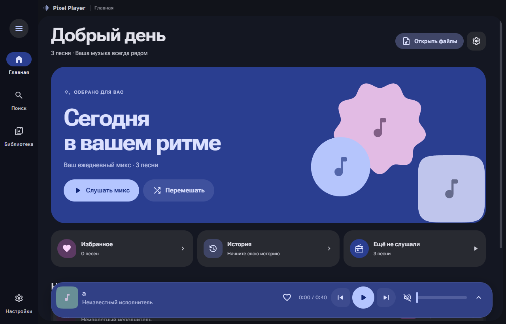
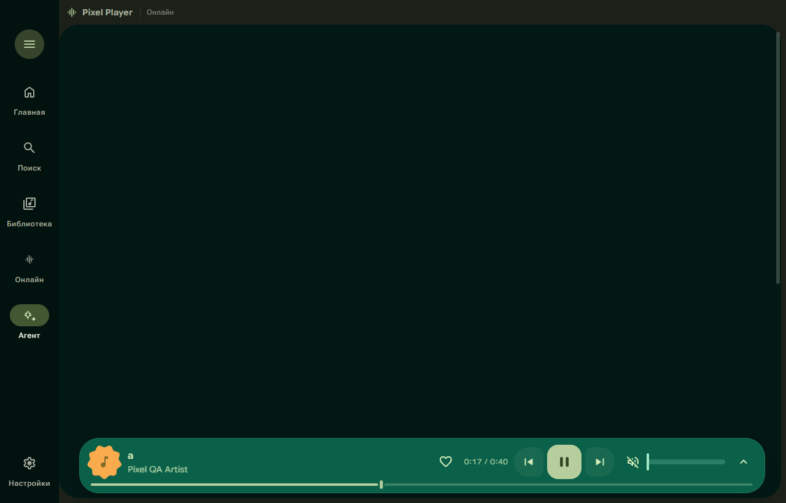

# Pixel Player 1.5 — Windows x64

Портативный музыкальный плеер с интерфейсом Material Design 3 Expressive.

[Скачать последнюю версию для Windows](https://github.com/N0pulsse/pixelplayer/releases/latest) · [Лицензия MIT](LICENSE)

## Запуск без установки

1. Скопируйте `PixelPlayer-portable-1.5.0-x64.exe` в свою папку или на флешку.
2. Запустите EXE двойным щелчком. Node.js и установка приложения не нужны.
3. Добавьте папку с музыкой, откройте файлы через **Ctrl+O** или перетащите их в окно.

Настройки, очередь, плейлисты, обложки и библиотека сохраняются в папке **PixelPlayer-data рядом с EXE**. Для переноса приложения на другой ПК переносите EXE вместе с этой папкой. Музыка в EXE не включается: переносите аудиофайлы отдельно; плейлисты с абсолютными путями требуют прежнего расположения файлов. Папка запуска должна разрешать запись. Приложение не создаёт установочных ярлыков и не требует прав администратора.

## Онлайн-сервисы в версии 1.5

В разделе **Онлайн** собраны Spotify, Яндекс Музыка и SoundCloud.

- **Spotify:** библиотека, избранное, альбомы, поиск и Spotify Connect. После команды запуска плеер проверяет реальное состояние воспроизведения. Если Spotify ответил успешно, но музыка не начала играть, появляется сообщение; локальная музыка продолжает работать. Ограничения Spotify Connect на текущем устройстве остаются в силе.
- **Яндекс Музыка:** официальный веб-плеер в отдельном окне Pixel Player. Войдите через Яндекс ID, чтобы открыть свою коллекцию, Мою волну и плейлисты. Подписка и регион определяются самим сервисом.
- **SoundCloud:** официальный веб-плеер в отдельном окне Pixel Player. Вход, лайки, подписки, лента и плейлисты доступны через интерфейс SoundCloud. Для этого режима Pixel Player не нужны API-ключи или Artist Pro разработчика.
- **Закладки:** сохраните название и ссылку на трек, альбом, исполнителя или публичный плейлист Яндекс Музыки / SoundCloud. Поддерживаются короткие ссылки `on.soundcloud.com` и новый формат плейлистов Яндекса. Закладки сохраняются после перезапуска; есть фильтр сервиса, открытие внутри приложения / в браузере и удаление закладки.
- **Отдельные профили сервисов:** вход сохраняется на этом ПК, куки Яндекса и SoundCloud разделены. Внешние страницы работают без Node.js, preload-моста и доступа к библиотеке Pixel Player. В разделе «О подключении» можно закрыть окно или очистить сохранённый вход одного сервиса.

Яндекс Музыка и SoundCloud в версии 1.5 работают через **официальные сайты**, а не через импорт их аккаунтов в локальную библиотеку. Их очередь и кнопки воспроизведения находятся в отдельных окнах. Полное прослушивание и вход зависят от сервиса, подписки, региона, поддержки встроенного браузера и защиты контента. Если сайт не работает в окне приложения, используйте кнопку открытия в обычном браузере. Плеер не скачивает музыку из этих сервисов и не передаёт их данные ИИ-агенту.

[Подробности о данных онлайн-сервисов](docs/ONLINE-SERVICES.md). [SoundCloud: регистрация API-приложений требует Artist Pro](https://developers.soundcloud.com/docs/api/register-app); ключи разработчика не вшиты в EXE.

## Подключение Spotify

Новый раздел **Spotify** показывает ваши плейлисты, любимые треки и сохранённые альбомы, позволяет искать музыку и управлять Spotify Connect: воспроизведение, пауза, переключение, перемотка, громкость, повтор и перемешивание. Выберите устройство Spotify на ПК, телефоне или колонке. При запуске Spotify локальная музыка ставится на паузу; возврат к локальным файлам приостанавливает выбранное устройство Spotify. Мини-плеер и команды управления учитывают текущий источник.

Требуется Spotify Premium и личное приложение Web API в [Spotify Developers](https://developer.spotify.com/dashboard). Укажите Redirect URI `http://127.0.0.1:43827/callback`, вставьте Client ID в разделе Spotify и войдите через браузер. Client Secret не нужен. Если устройство не видно, откройте официальный Spotify, включите любую песню и обновите устройства. В режиме разработки действуют ограничения Spotify на пользователей и запросы.

**Звук воспроизводит выбранное устройство Spotify**, а не встроенный декодер EXE. Музыка не скачивается. Эквалайзер, скорость, кроссфейд, синхронизированные тексты и ИИ-агент плеера относятся к локальной музыке. Токены зашифрованы Windows; на другом ПК войдите заново. Сборка и исходники не содержат персональных ключей и данных аккаунта. [Данные и отключение Spotify](docs/SPOTIFY-PRIVACY.md).

## Исправление 1.2.1

Индикатор сканирования теперь показывает анимированную музыкальную волну с кольцом прогресса. При уменьшении движения остаётся статичная узнаваемая иконка, которая не превращается в пустой квадрат. Используется SVG и CSS без покадровых вычислений JavaScript.

## Что нового в 1.2

- **Синхронизированные тексты** ищутся при выборе трека. Поиск предпочитает LRC даже при наличии обычного текста, проверяет исполнителя и длительность. Доступны повторный поиск и поправка тайминга ±30 секунд, сохраняемая отдельно для каждой песни.
- **Определение артистов и альбомов:** учтены совместные треки, Album Artist, компиляции и MusicBrainz ID. Одинаковые названия альбомов разных исполнителей не объединяются; гостевые участия отделены от собственной дискографии.
- **Полные страницы артистов:** фото, шапки, биографии, жанр, страна, год основания и дискография из TheAudioDB / Deezer. Для одноимённых артистов учитывается известный альбом из библиотеки. Результаты кэшируются; при отсутствии точного совпадения приложение показывает это явно. Интернет-каталог не означает наличие аудиофайлов: отсутствующий альбом открывается на сайте источника.
- **ИИ-агент плейлистов:** подключение совместимого с OpenAI Chat Completions API сервера по адресу, модели и ключу. Перед сохранением можно прослушать и отредактировать подборку. Агент выбирает только реальные треки выбранной коллекции, не выдумывает файлы.
- **11 тем:** Material, Blockcraft (в духе Minecraft), Nether, Midnight OLED, Sakura, Nord, Neon City, Forest, Ocean, Amber и Paper. Оригинальные игровые ассеты не используются. Есть готовые акценты и выбор любого цвета.
- **Wallpaper Engine / Windows:** автоматическое обновление палитры из превью активных обоев, включая GIF через декодер Windows. Если превью недоступно, используются системный акцент или обычные обои. Для меняющейся анимации можно включить в Wallpaper Engine изменение цвета Windows. Это не покадровый захват анимации и не захват экрана.
- **Открытия дня:** локальный разнообразный микс без API с учётом истории и избранного.

### Подключение агента

Откройте «Агент» → «Настроить API» или настройки приложения. Укажите базовый HTTPS-адрес API с `/v1` (либо полный `/chat/completions`), имя модели и API-ключ. Для локального сервера разрешён HTTP на localhost, например `http://127.0.0.1:11434/v1`; модель должна быть установлена и запущена отдельно.

Ключ шифруется средствами Windows и хранится в `PixelPlayer-data/ai-key.bin`. При переносе на другой ПК введите его заново. Запрос выполняется только по кнопке «Создать с ИИ»; отправляются запрос и ограниченный каталог названий/исполнителей/альбомов/жанров (до 600 треков и 48 тысяч символов). Пути и аудиофайлы не отправляются. Оплата API зависит от выбранного провайдера. Без подключения API остаётся доступен локальный микс.

### Синхронизация обоев

В настройках включите «Цвета обоев». Запущенный Wallpaper Engine определяется автоматически. При необходимости укажите папку его установки вручную. Источник текущего цвета отображается в интерфейсе. При нескольких мониторах используется первое доступное превью. Синхронизация не меняет файлы и настройки Wallpaper Engine.

## Возможности 1.1

- Новые главная и приветственный экран; тональные поверхности, выразительные формы, правильные размеры SVG-кнопок и доступные состояния клавиатурного фокуса.
- Пружинные переходы, морфинг кнопки воспроизведения, анимированные обложки и волновой прогресс. Учитываются системное уменьшение движения и переключатель в приложении.
- Настоящий **10-полосный эквалайзер** от 31 Гц до 16 кГц, шесть пресетов и ручная настройка ±12 дБ.
- **Скорость 0,5–2×** с сохранением высоты голоса, быстрый выбор на экране воспроизведения.
- Импорт M3U/M3U8, экспорт плейлиста и избранного в M3U8, сохранение очереди как плейлиста.
- Сведения о треке: формат, битрейт, частота дискретизации, теги и путь к файлу.
- Избранное, история, очистка истории, ежедневный микс и подборка ещё не прослушанных песен.
- Исправлены пауза и перемотка во время кроссфейда, конкурирующие загрузки, восстановление позиции, повтор с таймером сна и дубли в очереди.
- Исправлены папки с точками при перетаскивании, короткие аудиофайлы, отключение папок во время сканирования и сохранение данных при быстром выходе.
- Открытые внешние файлы, добавленные в плейлист или избранное, сохраняются в библиотеке между запусками.

## Остальные возможности

MP3, FLAC, M4A/AAC, OGG, Opus, WAV; обложки и теги, поиск музыки в стандартных папках и наблюдение за изменениями. Тёмная, светлая и системная темы; динамические цвета из обложек и семь вариантов палитры. Синхронные тексты из LRC, встроенных тегов и LRCLIB; перетаскивание очереди, таймер сна, кроссфейд, системные медиаклавиши и трей.

Онлайн-тексты и фото исполнителей можно отключить в настройках. Для локального воспроизведения интернет не требуется.

## Горячие клавиши

| Клавиши | Действие |
| --- | --- |
| Ctrl+O | Открыть аудиофайлы |
| Ctrl+F | Поиск |
| Пробел | Воспроизведение / пауза |
| ← / → | Перемотка на 5 секунд |
| Ctrl+← / Ctrl+→ | Предыдущий / следующий трек |
| ↑ / ↓ | Громкость, когда фокус вне прокручиваемого списка |
| M | Выключить / включить звук |
| L / Q | Тексты / очередь |
| Esc | Закрыть меню, диалог или экран воспроизведения |

Буквенные сочетания работают и при русской раскладке. В текстовых полях и диалогах управление воспроизведением не перехватывается.

## Разработка и сборка

Требуются Windows x64, Node.js и зависимости из `npm ci`.

- `npm start` — запуск исходников.
- `npm run watch` — пересборка интерфейса при изменениях.
- `npm run dist:portable` или `BuildExe.bat` — один портативный EXE в `release`.
- `npm run dist:installer` — отдельная сборка установщика при необходимости.
- `npm test` — проверки библиотеки, протокола и воспроизведения. Для старых тестовых аудиофикстур нужны FFmpeg и FFprobe в PATH.
- `node_modules\electron\dist\electron.exe test\electron-smoke.cjs` — проверка реального окна, аудио, эквалайзера и плейлистов с изолированными данными в `../qa`.

Код проекта — MIT. Шрифты Google Sans Flex / Roboto Flex — SIL OFL; Material Color Utilities и Material Symbols — Apache-2.0. Уведомления и полные тексты лицензий зависимостей находятся в [licenses](licenses/THIRD_PARTY_NOTICES.txt) и включаются в сборку. Реализация на Electron, React и Web Audio.
